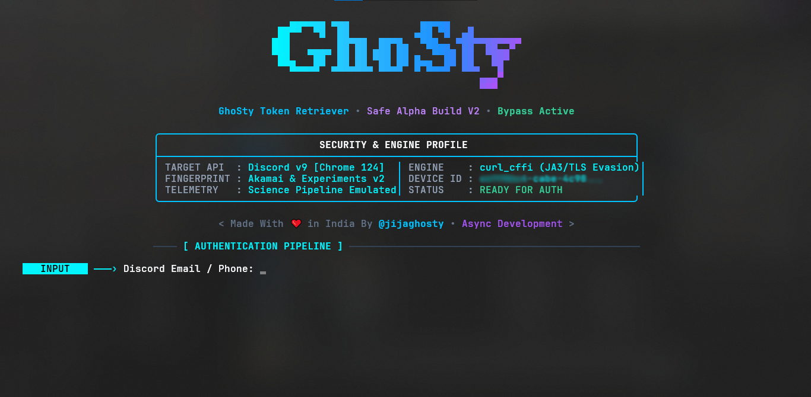

<div align="center">
  <a href="https://git.io/typing-svg">
    
  </a>
  <br/>
  <a href="https://discord.gg/asMJGgDA7u">
    
  </a>
  <br/>
  <small><p>Be sure to join our community server for updates, support & tools!<br>
  Need direct assistance? Shoot a friend request to <code>@jijaghosty</code> on Discord.</p></small>
</div>

---

A high-performance, stealth Discord account authentication and token retrieval tool equipped with full TLS fingerprint impersonation, telemetry emulation, and a modern terminal UI.

> [!IMPORTANT]
> ⚠️ **DISCLAIMER:** This software is provided strictly for educational, security auditing, and account recovery research purposes. Accessing Discord accounts programmatically must comply with Discord's Terms of Service. The developers accept zero liability for any misuse or account actions taken as a result of using this software.

<div align="center">
  
</div>

- 🛡️ **Chrome 124 TLS / JA3 Impersonation** - Powered by `curl_cffi` to evade Akamai & Cloudflare network heuristics.
- 🍪 **Automated DUID Cookie Seeding** - Automatically visits the login landing page to establish valid `__dcfduid`, `__sdcfduid`, and `_cfuvid` session cookies.
- 🔬 **Science Telemetry & Experiment Pipeline** - Extracts experiments fingerprints and dispatches authentic `login_page_viewed` tracking events to satisfy Discord anti-bot checks.
- 🔑 **Complete 2FA / TOTP Support** - Seamless handling of Multi-Factor Authentication tickets with clean code prompts.
- 👤 **Instant Profile Metadata Extraction** - Automatically retrieves account details upon login (Global Display Name, Tag, ID, Verified Email, Phone Number, Nitro tier, 2FA status).
- 💾 **Automatic Token Vault Logging** - Appends acquired tokens with timestamps into `token.txt`.

<div align="center">
  
</div>

### 1️⃣ Requirements

- Python 3.10+ installed
- Windows 10/11 (or Linux/macOS with terminal ANSI support)

### 2️⃣ Install Dependencies

```bash
pip install -r requirements.txt
```

### 3️⃣ Running the Tool

Launch the build directly:

```bash
python main.py
```

Enter your Discord email/phone and password when prompted. If 2FA is enabled on your account, enter the 6-digit TOTP code.

---

<div align="center">
  
</div>

#### 1. TLS Fingerprint Evasion (`curl_cffi`)
Standard Python `requests` or `urllib` send OpenSSL cipher suites and TLS extensions that Cloudflare and Akamai instantly flag as automated scripts. `stealth.py` uses `curl_cffi` with `chrome124` browser impersonation, matching legitimate browser JA3/JA4 fingerprints and HTTP/2 settings.

#### 2. Super Properties & Fingerprint Header Matrix
Every request builds authentic `X-Super-Properties` reflecting Windows 10 / Chrome 124, combined with a unique persistent `X-Discord-Device-Id` and experimental fingerprint extracted from Discord's `/api/v9/experiments` endpoint.

#### 3. Science Telemetry Emulation
Standard bots hit `/api/v9/auth/login` directly without interaction history. GhoSty Token Retriever emulates browser behavior:
1. Hits `https://discord.com/login` to seed DUID cookies.
2. Emits `login_page_viewed` events to `/api/v9/science`.
3. Submits authentication payloads with human-like timing delays.

---

<div align="center">
  
</div>

<div align="center">
  <center></center>
  <br>
  <p><b>Terminal Console Interface</b></p>
</div>

---

<div align="center">
  
</div>

<div align="center">
  <p><b>GhoSty | Brutality (Async Development)</b></p>
  <a href="https://discord.com/users/940896719045034024" target="_blank">
    
  </a>
</div>

<div align="center">
  
</div>

If this tool has been helpful, consider supporting future development!

**LTC (Litecoin) Wallet:**
```
LbeKrDeUF7mTB8LZLHkjicQfEW6tyhVGny
```

Alternatively, support directly via **[Donatree](https://donatr.ee/brutality/)**.

---

<div align="center">
  
</div>

- **🚫 Unauthorized reselling or redistribution of this software is strictly prohibited.**
- **🛡️ Please use this software responsibly for personal account recovery and legitimate security testing only.**

---

<div align="center">
  <i>Thanks for checking out GhoSty Token Retriever! Built with ❤️ by Async Development.</i>
  <br><br>
  
</div>

<br>
<details>
<summary>Keywords</summary>
discord token retriever, discord token fetcher, discord token grabber python, discord login token, discord api v9, curl_cffi discord, akamai bypass discord, cloudflare tls bypass discord, ja3 fingerprint discord, discord science telemetry, discord experiments fingerprint, discord 2fa totp token, discord account retriever, async development, ghosty, jijaghosty
</details>
